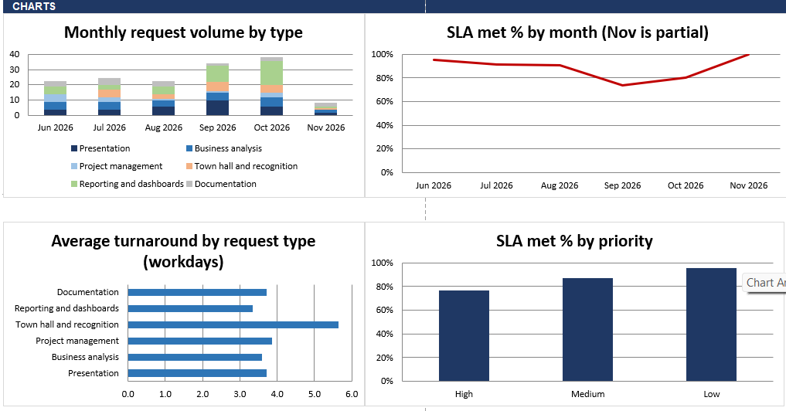

# 📊 Business Operations & Delivery Dashboard

<div align="center">


<br/>

A business analytics project built with Microsoft Excel to explore operational data, monitor delivery performance, and present meaningful insights.

<br/>


</div>

---

## 🚀 Project Overview

The Business Operations & Delivery Dashboard is an Excel-based analytics project designed to organize and visualize operational and delivery-related information.

It demonstrates the use of spreadsheet-based analytics and visualization to make business information easier to understand.

## 📸 Dashboard Preview

<!-- Add your actual dashboard screenshot here -->

<div align="center">

<!-- Replace with your uploaded GitHub image URL -->



</div>

## ✨ Key Features

- 📊 Business operations visualization
- 🚚 Delivery performance monitoring
- 📈 Structured data reporting
- 🔍 Operational data exploration
- 💡 Business-focused analytical presentation

## 🛠️ Technology Stack

| Technology | Purpose |
|---|---|
| Microsoft Excel | Dashboard development |
| Data Analytics | Operational analysis |
| Data Visualization | Visual reporting |

## 📂 Project Structure

```text
Business_Operations_Delivery_Dashboard/
│
├── Business_Operations_Delivery_Dashboard.xlsx
└── README.md
```

## ⚙️ Getting Started

**1. Clone the repository**

```bash
git clone https://github.com/shaikumar11/Business_Operations_Delivery_Dashboard.git
```

**2. Open the project folder**

```bash
cd Business_Operations_Delivery_Dashboard
```

**3. Open the Excel workbook**

Open `Business_Operations_Delivery_Dashboard.xlsx` using Microsoft Excel.

## 🎯 Project Goals

- Improve business data visibility.
- Present operational information effectively.
- Demonstrate practical Excel analytics skills.
- Support data-driven business reporting.

## 🔮 Future Improvements

- Advanced interactive filtering.
- Automated data refresh.
- Power BI integration.
- Web-based interactive dashboard.

## 👨‍💻 Author

**Shaik Mohammed Umar**

[](https://github.com/shaikumar11)

[](https://linkedin.com/in/mohammed-umarshaik)

---

<div align="center">

### ⭐ If you find this project interesting, consider giving it a star!


</div>
